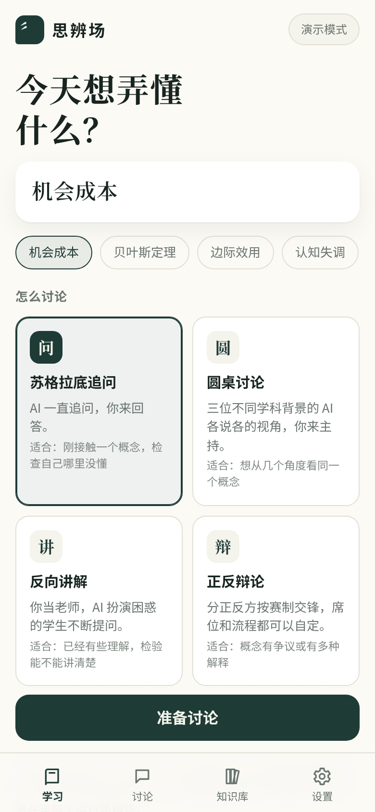
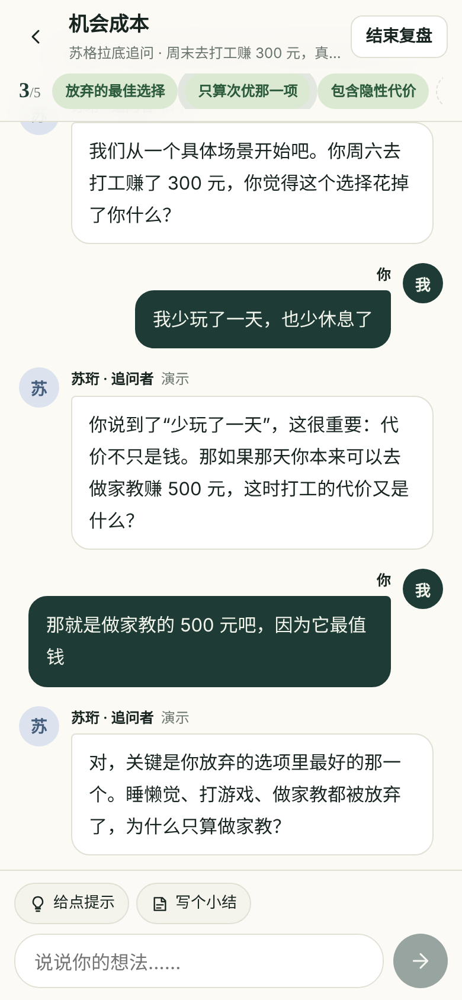
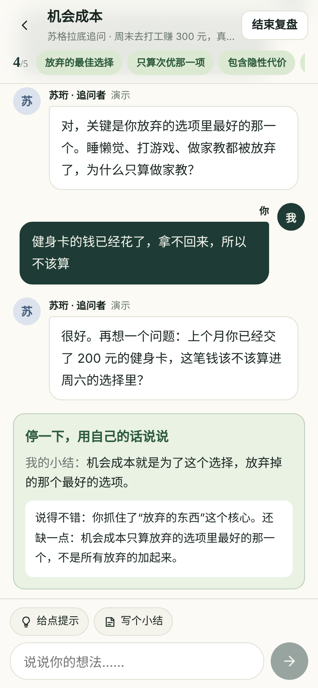
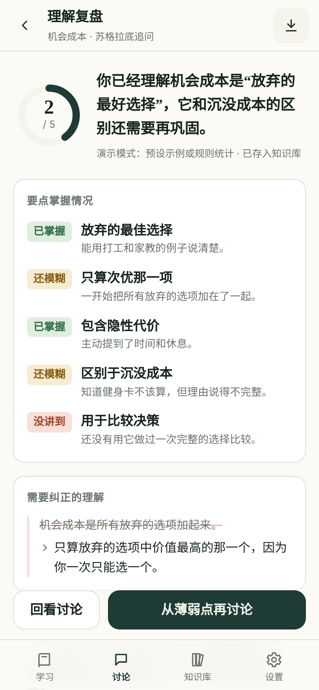

# 思辨场

**把一个概念真正聊明白。**

写下你想弄懂的概念，和 AI 讨论、被 AI 追问、或者和 AI 辩论。讨论中讲清楚的要点会被点亮；结束后，思辨场会告诉你哪些已经懂了、哪些还模糊，把这份复盘存进知识库，过几天再提醒你回顾。

[**在线体验**](https://maxlen727.github.io/debating-ground/app/) · [**产品文档**](https://maxlen727.github.io/debating-ground/) · [快速开始](https://maxlen727.github.io/debating-ground/guide/getting-started)

  
  
  
  

## 为什么用讨论来学

读一遍定义，常常会产生“我懂了”的错觉。真正的理解经得起追问：换个情境还成立吗？能举出例子吗？别人反驳时站得住吗？思辨场把追问交给 AI，让你在回答、解释、反驳的过程中，自己发现哪里没想清楚。

它不是练口才的工具，**目标始终是把概念弄懂**。

## 能做什么

- **从概念出发**：AI 先拆出真正理解它需要掌握的几个要点，再出一道适合讨论的题目。开始前都可以改。
- **四种讨论方式**：

  | 方式 | 你在做什么 | 适合什么时候 |
  | --- | --- | --- |
  | 苏格拉底追问 | 回答 AI 的连续追问 | 刚接触概念，检查自己哪里没懂 |
  | 圆桌讨论 | 主持三位不同学科的 AI 嘉宾 | 想从几个角度看同一个概念 |
  | 反向讲解 | 当老师，讲给困惑的 AI 学生听 | 检验自己能不能讲清楚 |
  | 正反辩论 | 在正方或反方席位上交锋，席位和流程可自定 | 概念有争议或有多种解释 |

- **随时追问**：轻点 AI 的任意一句话，让它换个说法、举个例子，或说清楚哪些是事实、哪些是观点。遇到陌生的术语，带虚线的词点一下就有解释卡片。卡住了可以要一条只给思路、不给答案的提示。
- **停下来说说**：讨论到一半，请你用自己的话写一句小结，AI 指出说对的部分和最关键的遗漏。
- **边讨论边补充要点**：发现还有想弄懂的地方，随时加一条；也可以让 AI 提议，由你决定要不要。
- **朗读**（可选）：后端配好讯飞语音后，每条发言都可以点开来听。
- **诚实的复盘**：逐条评估要点（已掌握 / 还模糊 / 没讲到），纠正误解，出几道检验题。只看你本人的发言，AI 说过的不算你懂了。
- **和同学一起讨论**：圆桌和辩论可以发一个邀请链接，同学用自己的手机加入，和 AI 一起轮流发言；结束后每个人只按自己的发言拿到复盘。详见[和同学一起讨论](https://maxlen727.github.io/debating-ground/guide/multiplayer)。
- **落盘与回顾**：复盘自动存成知识卡片，按 1、3、7、14 天的间隔提醒回顾。复习时先凭记忆做题，再看上次的复盘；还可以从薄弱点再讨论一次。

## 怎么开始

**在线体验**：打开 [maxlen727.github.io/debating-ground/app](https://maxlen727.github.io/debating-ground/app/)，不用安装。在线版默认是演示模式，AI 回复来自预设模板，推荐用“机会成本”体验完整流程。

**和真实 AI 讨论**，有两种方式：

- **在网页上**：把思辨场的后端部署到你自己的 Cloudflare 账号（免费额度就够）。点下面的按钮，登录 Cloudflare 和 GitHub，按提示填写 AI 服务商的信息和一个访问口令，就部署好了：

  

  然后在在线版的 **设置** 里选择 **我的后端**，填写后端地址和访问口令。详见[自己部署后端](https://maxlen727.github.io/debating-ground/guide/self-host)。
- **在电脑上运行**：安装 [Node.js](https://nodejs.org/) 22.18 以上，下载本项目后：

  Windows 双击 `start.cmd`；macOS / Linux 运行 `npm install && npm run build && npm start`。

  然后打开 http://127.0.0.1:4173 ，在 **设置** 里填写你的 AI 服务商地址、模型和 API Key。支持兼容 OpenAI Chat Completions 协议的服务。详见[快速开始](https://maxlen727.github.io/debating-ground/guide/getting-started)。

## 你的密钥去了哪里

只要密钥经过某台服务器，那台服务器就能看到它，我们没法用技术手段证明自己没偷看。所以思辨场的方向是**尽量让密钥不经过我们**：

- **在电脑上运行**：密钥只保存在本机服务的内存里，不写入硬盘、浏览器存储或日志，直接发往你选择的服务商。
- **自己部署的后端**：后端运行在你自己的 Cloudflare 账号里，密钥存成加密变量，浏览器里不需要密钥，只保存后端地址和访问口令。部署在你自己的账号里，你只需要信任你自己。
- **安卓 App（开发中）**：单人模式由手机直接请求 AI 服务商，密钥存在系统的安全存储里。**思辨场团队的服务器全程碰不到它。**

不管用哪种方式，都建议**专门为思辨场新建一个 Key 并设置消费上限**，不用了就作废。讨论记录和知识库只保存在你的设备上，不接入任何第三方统计。详见[密钥与隐私](https://maxlen727.github.io/debating-ground/guide/api-and-privacy)。

## 路线图

- [x] 四种讨论方式、要点点亮、追问与提示、小结卡
- [x] 理解复盘、知识库与间隔复习
- [x] 移动优先的界面，深色模式
- [ ] 安卓 App，单人模式直连服务商
- [x] 可自部署的后端（Cloudflare Workers），网页版也能用真实 AI
- [x] 多台设备联网讨论（圆桌、辩论）
- [x] 流式输出：AI 边想边说，文字平滑地逐字出现
- [ ] 知识库跨设备同步

完整内容见[路线图](https://maxlen727.github.io/debating-ground/product/roadmap)。

## 参与开发

思辨场由一个学生团队开发，大部分工作由成员指挥 AI Agent 完成。

- [开发指南](https://maxlen727.github.io/debating-ground/dev/)：环境、命令、项目结构、测试。
- [CONTRIBUTING.md](CONTRIBUTING.md)：分工、任务流程、审查要点。
- [AGENTS.md](AGENTS.md)：所有 AI Agent 在本仓库里的行为规范。

技术栈：React + Vite + TypeScript，本机服务由 Node 原生运行 TypeScript，文档站使用 VitePress。
